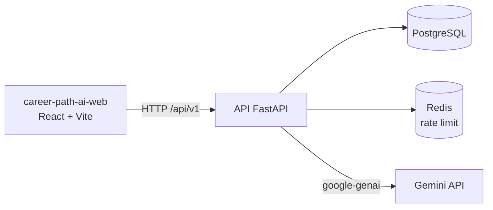

# CareerPath-AI API

[](https://github.com/daviolvr/career-path-ai-api/actions/workflows/ci.yml)

Plataforma que usa o **Google Gemini** para ajudar pessoas de tecnologia a planejar a carreira. A partir de um currículo em PDF e de dados informados pela pessoa, ela gera:

- **Análise de currículo**: resumo profissional, nível de senioridade, habilidades técnicas encontradas, recomendações de carreira, lacunas de habilidade, cargos sugeridos e insights de mercado.
- **Guia de entrevista**: roteiro de preparação (técnica, comportamental e plano de estudo) cruzando o currículo com a descrição de uma vaga.
- **Trilha de desenvolvimento**: plano em fases, com projetos, recursos e marcos, adaptado ao prazo, à disponibilidade semanal e ao nível da pessoa.

Cada resultado fica salvo no histórico da conta, que também tem cadastro, login, renovação de sessão, recuperação de senha e edição/exclusão do perfil.

Este repositório é a **API**. A interface web (React + Vite) fica em [`career-path-ai-web`](https://github.com/daviolvr/career-path-ai-web).

## Arquitetura em uma imagem



A API segue camadas bem separadas (rotas → serviços → repositórios → modelos), com erros de domínio traduzidos em um envelope único, uma transação por caso de uso e uma camada própria para o LLM. Detalhes em [`docs/arquitetura.md`](docs/arquitetura.md), e o *porquê* de cada escolha em [`docs/decisoes.md`](docs/decisoes.md).

## Tecnologias

| Área | Escolhas |
|---|---|
| API | Python 3.13, FastAPI, Pydantic v2, SQLAlchemy 2 (assíncrono), Alembic |
| Dados | PostgreSQL 17, Redis 7 (contadores de rate limit) |
| IA | `google-genai` (Gemini), saída estruturada por schema Pydantic, prompts versionados |
| Segurança | JWT (access/refresh/reset), bcrypt, rate limiting com `limits`, CORS restrito |
| Qualidade | pytest, ruff, mypy, GitHub Actions |
| Frontend | repositório separado ([`career-path-ai-web`](https://github.com/daviolvr/career-path-ai-web)): React + Vite |

## Como executar (Docker)

Pré-requisitos: Docker, Docker Compose e uma chave da API do Gemini.

```bash
git clone https://github.com/daviolvr/career-path-ai-api.git
cd career-path-ai-api

cp .env.example .env     # um único arquivo: preencha-o (veja abaixo)
docker compose up --build
```

As migrations rodam sozinhas na inicialização da API. Os campos obrigatórios do `.env` e o que cada um faz estão em [`docs/desenvolvimento.md`](docs/desenvolvimento.md#configuração). O mesmo arquivo serve ao compose, ao container da API e a quem roda a API fora do Docker: dentro do container o compose sobrescreve `POSTGRES_HOST`, `POSTGRES_PORT` e `REDIS_URL`. Preencha `FRONTEND_HOST` com a origem do frontend (`http://localhost:5173`, para o CORS). O `SECRET_KEY` precisa ter **pelo menos 32 caracteres**; para gerar um:

```bash
python3 -c "import secrets; print(secrets.token_urlsafe(48))"
```

| Serviço | Endereço |
|---|---|
| API | http://localhost:8000 |
| Swagger UI | http://localhost:8000/docs |
| ReDoc | http://localhost:8000/redoc |
| PostgreSQL (do host) | `localhost:5433` |

O Redis fica só na rede interna do compose (sem porta publicada). Comandos úteis: `docker compose logs -f api`, `docker compose down` (e `down -v` para apagar também o banco).

### Com a interface web

Clone o [frontend](https://github.com/daviolvr/career-path-ai-web) **ao lado** deste repositório (`../career-path-ai-web`) e suba o perfil completo:

```bash
docker compose --profile full up --build   # interface em http://localhost:5173/login
```

Para rodar a API fora do Docker, ver [`docs/desenvolvimento.md`](docs/desenvolvimento.md).

## API em resumo

Prefixo `/api/v1`. As rotas com 🔒 exigem `Authorization: Bearer <access token>`.

| Grupo | Rotas |
|---|---|
| Autenticação | `POST /auth/register`, `/auth/login`, `/auth/login-form`, `/auth/refresh` 🔒, `/auth/logout` 🔒, `/auth/forgot-password`, `/auth/reset-password` |
| Usuário | `GET /users/me` 🔒, `PATCH /users/me` 🔒, `DELETE /users/me/delete` 🔒 |
| Análise de currículo | `POST /resume-analysis/` 🔒 (PDF), `GET /resume-analysis/` 🔒, `GET`/`DELETE /resume-analysis/{id}` 🔒 |
| Guia de entrevista | `POST /interview-guide/` 🔒 (PDF + vaga), `GET /interview-guide/` 🔒, `GET`/`DELETE /interview-guide/{id}` 🔒 |
| Trilha de desenvolvimento | `POST /development-trail/` 🔒, `GET /development-trail/` 🔒, `GET`/`PATCH`/`DELETE /development-trail/{id}` 🔒 |
| Saúde (sem o prefixo `/api/v1`) | `GET /health` (liveness), `GET /ready` (Postgres e Redis: 503 se o Postgres cair, 200 `degraded` se só o Redis cair) |

Todo erro usa o mesmo formato:

```json
{ "error": { "status": 429, "code": "rate_limit_exceeded", "message": "Muitas requisições. ..." } }
```

Os limites de requisição (HTTP 429, com `Retry-After`) estão na [arquitetura](docs/arquitetura.md#rate-limiting).

## Qualidade

- **Testes:** 314 testes em `tests` (unitários, com repositórios e LLM falsos; e de integração, contra PostgreSQL e Redis reais, que só rodam quando `TEST_DATABASE_URL` e `REDIS_TEST_URL` estão definidos). Os testes nunca chamam o Gemini.
- **CI** (GitHub Actions): `ruff check`, `ruff format --check`, `mypy`, a suíte completa com PostgreSQL 17 e Redis como serviços, e o build da imagem Docker.
- **Avaliação da IA:** há um conjunto de avaliação sintético e manual em [`evals`](evals/README.md), separado dos testes porque usa a rede e gasta cota.

Como rodar cada uma dessas verificações: [`docs/desenvolvimento.md`](docs/desenvolvimento.md#qualidade).
