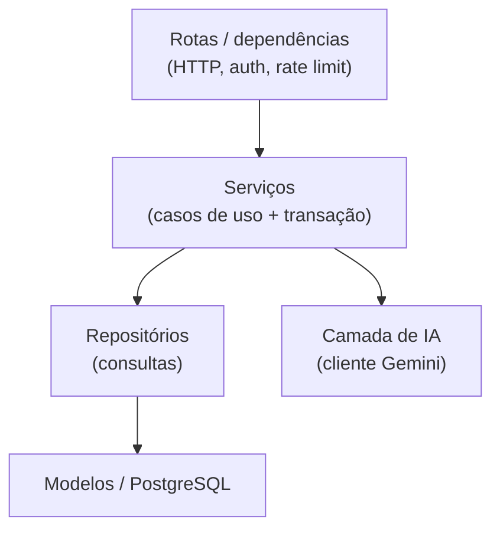
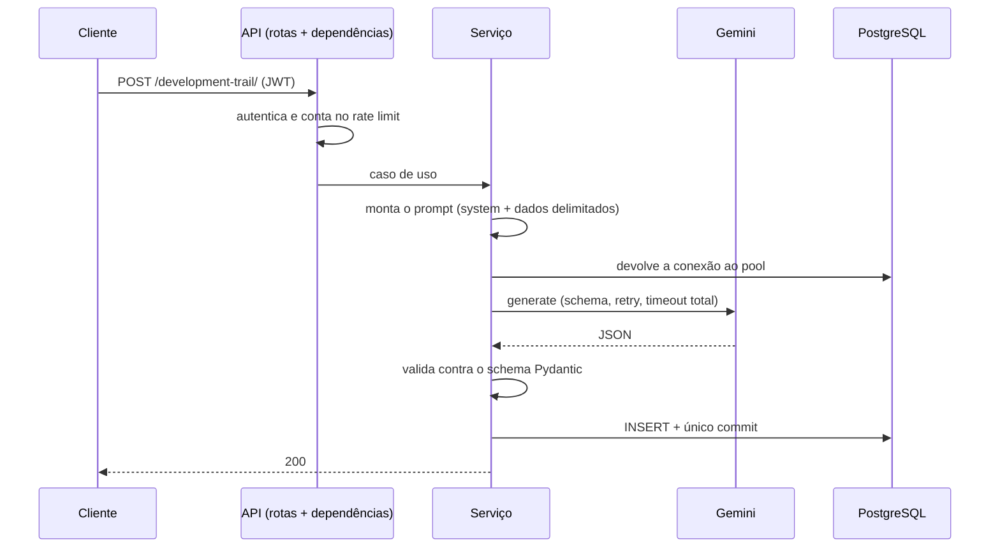

# Arquitetura do backend

Este documento descreve **como o backend funciona hoje**. As alternativas que foram consideradas e o motivo de cada escolha estão em [`decisoes.md`](decisoes.md); o que não foi verificado está em [`limitacoes.md`](limitacoes.md).

## Estrutura

```
backend/
├── app/
│   ├── main.py                  # cria a app, CORS, handlers de erro, agendador
│   ├── api/v1/
│   │   ├── routes/              # rotas finas: validam entrada e chamam um serviço
│   │   └── dependencies/        # autenticação, rate limit e injeção de serviços
│   ├── services/                # casos de uso (regras de negócio e transação)
│   ├── repository/              # acesso a dados (SQLAlchemy)
│   ├── models/                  # tabelas (SQLAlchemy 2, tipadas)
│   ├── schemas/                 # contratos HTTP e o formato das saídas da IA (Pydantic)
│   ├── llm/                     # cliente do Gemini, prompts versionados, validação da saída
│   ├── core/                    # config, banco, segurança, exceções, rate limit, agendador
│   └── utils/                   # PDF, tokens, montagem de prompts
├── migrations/                  # Alembic
├── tests/                       # unitários e de integração
├── evals/                       # avaliação manual da geração com IA
└── scripts/                     # utilitários manuais (ex.: checar a chave do Gemini)
```

## Camadas



Regras que o código segue:

- **Rotas** não têm regra de negócio: validam o corpo, resolvem dependências e delegam.
- **Serviços** concentram a regra, decidem quando a operação terminou e fazem o `commit`.
- **Repositórios** só consultam e fazem `flush`; nunca `commit`.
- Falhas esperadas viram **exceções de domínio** (`core/exceptions.py`). `HTTPException` só aparece na camada de apresentação (`dependencies/security.py`), onde o 401 precisa do cabeçalho `WWW-Authenticate`.
- O serviço recebe o cliente de IA por **injeção** (`LLMClient`), o que permite testá-lo com um LLM falso, sem rede.

## Envelope de erros

Os handlers centrais (`core/exception_handlers.py`) traduzem qualquer exceção para um único formato:

```json
{ "error": { "status": 422, "code": "request_validation_error", "message": "...", "details": [{ "field": "...", "message": "..." }] } }
```

| Origem | Status | Observação |
|---|---|---|
| Validação do corpo | 422 | `details` por campo, **sem ecoar o valor recebido** (`hide_input_in_errors`) |
| Recurso inexistente ou de outro usuário | 404 | os dois casos são indistinguíveis de propósito |
| Conflito (e-mail já usado) | 409 | |
| Limite de requisições | 429 | com `Retry-After` |
| Falha do provedor de IA | 502 | `ai_provider_error`, `ai_timeout`, `ai_invalid_response`… sem detalhes do SDK |
| Dependência nossa fora do ar | 503 | `rate_limiter_unavailable` (só na geração com IA) |
| Exceção não prevista | 500 | mensagem genérica; o detalhe vai só para o log |

## Fronteira transacional

Cada caso de uso de escrita faz **exatamente um** `commit`, no serviço. Os repositórios só dão `flush`/`refresh`. Se algo falha antes do `commit`, `get_db` faz `rollback`.

Na geração com IA, isso significa que **nada é salvo se o modelo falhar ou devolver algo inválido**: o `commit` só acontece depois de a resposta ser validada. Há testes que contam os commits com uma sessão falsa e testes de integração com PostgreSQL real.

## Autenticação

- **Três tipos de token**, distinguidos pela claim `type`: `access`, `refresh` e `reset_password`. Um não vale no lugar do outro (testado). Cada token tem um `jti` para ser único.
- **A troca de senha encerra as sessões.** Access e refresh levam a claim `pwd`, a impressão (HMAC) do hash da senha com que foram emitidos. `_authenticate` compara a claim com a senha atual do usuário; se a senha mudou, ou se o token não tem a claim, a resposta é 401. Não há estado extra no banco. Consequência: tokens emitidos antes dessa claim existir deixaram de valer e as pessoas precisaram entrar de novo uma vez.
- **Rotação do refresh token.** `POST /auth/refresh` devolve um novo access **e um novo refresh**; o refresh usado é revogado na hora. O novo herda a expiração do original, então a sessão acaba no máximo `REFRESH_TOKEN_EXPIRE_DAYS` depois do login, por mais que seja renovada. A revogação é um `INSERT ... ON CONFLICT DO NOTHING` na blacklist: se duas renovações chegam juntas com o mesmo refresh, o banco decide e só uma vence; a outra recebe 401 (`refresh_token_reused`), nunca 500. O frontend guarda o refresh novo em `utils/apiClient.js`.
- **Logout** coloca o access token (e o refresh, se enviado) numa *blacklist* no banco, que guarda **só o `jti`** e a expiração (nunca o JWT); uma tarefa agendada (a cada 24 h) remove os expirados.
- **Redefinição de senha:** o token carrega uma impressão (HMAC) do hash da senha atual, então **só pode ser usado uma vez**: depois de trocar a senha, o mesmo link deixa de valer.
- **Login e recuperação não revelam quais contas existem.** O login executa uma verificação de senha fictícia quando o e-mail não existe; antes disso, a diferença de tempo era mensurável (≈219 ms a mais para e-mails existentes, em uma medição local; depois, 222 ms contra 221 ms).
- `SECRET_KEY` com menos de 32 caracteres impede a API de iniciar. O CORS aceita apenas a origem configurada em `FRONTEND_HOST`.

## Camada de IA



Peças (`app/llm/`):

- **`GeminiClient`** (`client.py`): cliente assíncrono do `google-genai`. Traduz os erros do SDK em exceções de domínio, aplica retry com backoff apenas a falhas transitórias (500, 502, 503, 504 e erros de rede; **não** a 429, 4xx nem timeout) e impõe um **teto de tempo para todas as tentativas somadas**. Registra latência e contagem de tokens, nunca o conteúdo.
- **Saída estruturada:** cada caso de uso tem um modelo Pydantic (`schemas/ai_outputs.py`) enviado ao Gemini como `response_schema` e usado depois para validar a resposta. Se a resposta sair do contrato, vira `ai_invalid_response` e **não é consertada nem salva**.
- **Prompts versionados** (`llm/prompts/v1/*.md`), enviados como `system_instruction`. Texto de usuário e de terceiros (currículo, vaga, campos do formulário) vai separado, dentro de tags tratadas como **dado, nunca instrução**, com `<` e `>` neutralizados para não fechar a tag.
- **Limites de entrada aplicados em código:** tamanhos dos campos da trilha, descrição da vaga (5000 caracteres), PDF (5 MB, 30 páginas) e truncamento do texto enviado (currículo 6000, vaga 2000 caracteres).
- **Raciocínio (*thinking*) desligado por padrão** (`GEMINI_THINKING_BUDGET=0`), configurável. Ver a justificativa e a ressalva em [`decisoes.md`](decisoes.md).

## Conexões de banco durante a espera do LLM

A autenticação faz consultas na mesma sessão do caso de uso, o que abre uma transação e prende uma conexão do pool. Como a chamada ao Gemini pode durar segundos, os serviços de geração chamam `release_connection` (um `session.close()`) logo antes dela. Sem isso, num teste com pool de 1 conexão, três gerações simultâneas terminavam em `QueuePool timeout`. A sessão reabre uma conexão na próxima consulta.

## Rate limiting

Janela móvel (`limits`) sobre Redis, aplicada por dependências do FastAPI (`api/v1/dependencies/rate_limit.py`). Os valores são configuráveis (`RATE_LIMIT_*`):

| Rota | Limite padrão | Chave | Se o Redis cair |
|---|---|---|---|
| `login` | 5/min | IP + hash do e-mail | segue (*fail-open*) |
| `login-form` | 5/min | IP | segue |
| `register` | 3/min | IP | segue |
| `forgot-password` | 3/hora | IP | segue |
| `forgot-password` (por e-mail) | 3/hora | hash do e-mail, de qualquer IP | segue |
| `refresh` | 30/min | IP | segue |
| `logout` | 30/min | IP | segue |
| `reset-password` | 10/hora | IP | segue |
| Geração com IA (3 rotas) | 3/min e 10/hora | usuário | **503** (*fail-closed*) |
| Geração com IA, global | 20/min | todos | **503** |

- O e-mail nunca aparece nas chaves do Redis, só um hash.
- O IP vem da conexão. `X-Forwarded-For` só é lido se `TRUSTED_PROXY_COUNT` estiver configurado, porque o cliente pode forjar esse cabeçalho.
- Depois de uma falha do Redis, o limitador **não o consulta por 10 s** (*circuit breaker*). Sem isso, medi ~3 s de espera em cada requisição durante a queda.
- Sem `REDIS_URL`, o contador fica em memória do processo: serve para desenvolvimento, mas não é compartilhado entre processos e zera a cada reinício.

## Banco de dados e migrations

PostgreSQL com SQLAlchemy 2 assíncrono (`asyncpg`) e modelos tipados (`Mapped`). O Alembic gerencia o schema; as migrations rodam automaticamente na subida do container do backend. Um teste de integração (`test_schema_drift.py`) falha se os modelos e as migrations divergirem. As colunas de data usam `TIMESTAMPTZ`.
